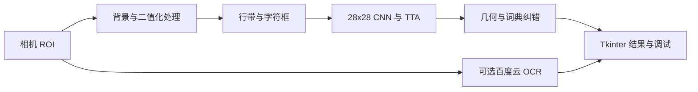
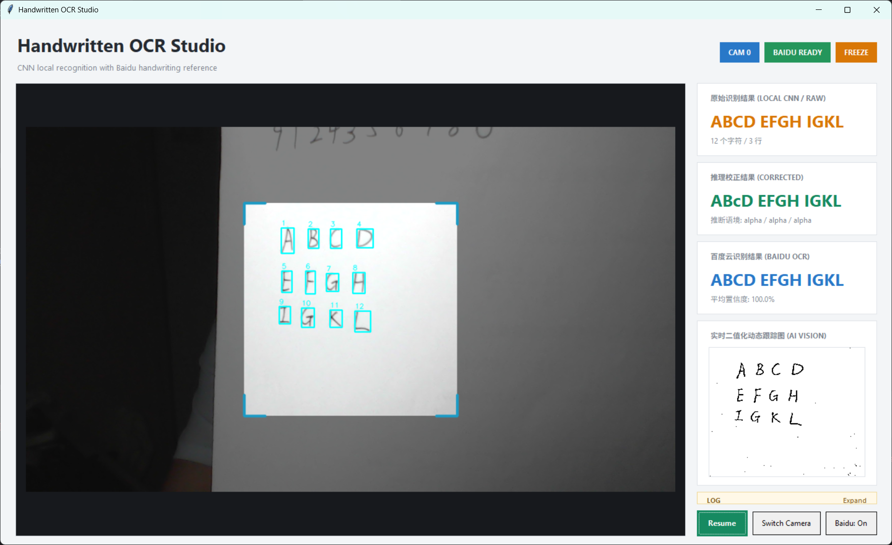

# Handwritten Character Recognition and Correction

面向数字及大小写英文字母的相机 OCR、字符分割与词典／几何纠错实验系统。

**简体中文** · [English](README_EN.md) · [日本語](README_JA.md)

**深入阅读：** [技术说明](docs/technical-notes.zh-CN.md) · [部署与操作](docs/setup.zh-CN.md)

项目以 PyTorch 的 62 类 CNN 为单字分类器，将 OpenCV 图像预处理、行带分割、字符归一化、测试时增强和规则纠错接入 Tkinter 工作台。重点是把单字分类扩展为可观察、可交互的文字序列处理流程；百度手写 OCR 是可选的云端参考，不参与本地 CNN 训练。

## 处理流程



主入口是 `desktop_app.py`。相机预览在 GUI 线程更新，按空格定格后把 ROI 交给一个后台工作线程；本地处理完成后才请求可选云端 OCR，二者不是并行返回。

## 核心功能与工程设计

| 模块 | 实际实现 |
| :--- | :--- |
| 图像适应 | 边缘灰度判断背景；亮底走背景除法、CLAHE、自适应阈值，暗底走滤波与 Otsu。 |
| 字符分割 | 水平投影行带、行内轮廓、迭代框合并、宽框投影切分、横／竖阅读顺序启发式。 |
| 分类推理 | 三卷积块、SiLU、BatchNorm、Dropout；单字28×28，62类；9平移+2旋转的平均概率。 |
| 规则纠错 | 长宽比、全局相对高度、形近数字折叠、同长度英文词典对数似然和格式概率掩码。 |
| 工作台 | 原始／修正／云端结果、低置信度Top-3、二值图、编号字符框、定格／恢复与相机切换。 |

[源码、网络结构与公式](docs/technical-notes.zh-CN.md)。词典方法不是生成式语言模型；格式掩码也不是完整证件校验或汉字车牌识别。

## 展示与验证范围



仓库保留数字、多行字母、手机号及混合序列截图，以及训练曲线和混淆矩阵图片。它们展示历史界面与结果，不单独证明准确率或当前版本的性能。

本轮执行了3项分割断言及7组纠错用例，均通过。没有重新训练、进行摄像头实测或调用云接口。历史消融 JSON 有记录，但其合成序列和真值几何条件不能作为真实相机端到端成绩；[评测范围](docs/technical-notes.zh-CN.md#evaluation)保留原数值和限制。

## 快速开始

1. 在支持 Tkinter 的 Python 3.10+ 环境安装 `requirements.txt`，按实际 GPU 选择兼容的 PyTorch／torchvision。
2. 通过[历史权重发布与校验](docs/checkpoint.zh-CN.md)获取匹配检查点；权重作为 Release 资产提供，仍不纳入 Git。已有本机权重不会被自动覆盖。
3. 在仓库根目录运行：

```powershell
python desktop_app.py
```

Space 识别／恢复，Enter/Esc 恢复，C 切换相机，B 切换云端参考，Q 退出。[完整操作、凭证和训练说明](docs/setup.zh-CN.md)。

## 实现边界与后续

仅识别 `0–9/A–Z/a–z`，没有中文、标点或连续手写端到端序列模型。分割、排版和纠错依赖启发式，可能切错、合错或误改专名。

训练90%/验证10%使用固定种子42和不重叠索引，验证视图独立且不使用随机增强；训练和DataLoader工作进程设置种子。已有历史曲线没有重新生成，修复不代表准确率已提升。 2026-10-23修复：缺失或不兼容权重立即报错，不使用随机模型继续识别；桌面入口给出初始化错误。7项新增可靠性测试、原3项分割断言和7组纠错用例通过，没有重新训练、相机评测或云请求。后续需要独立真实照片评测与数据/权重版本记录。

## 归属与许可

仓库由 **刘超然 / Chaoran Liu** 维护。源码展示 CNN、图像处理、解码和界面的整合；个人与团队的细分贡献尚无独立记录，不据此扩张为全部原创算法。

应用代码见 [MIT 许可证](LICENSE)；PyTorch、torchvision、OpenCV、EMNIST 数据及百度服务分别遵循各自条件。[技术说明](docs/technical-notes.zh-CN.md) · [部署指南](docs/setup.zh-CN.md)
