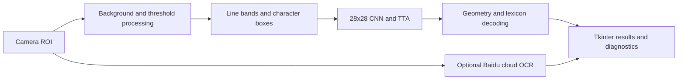

# Handwritten Character Recognition and Correction

Camera-based alphanumeric OCR with character segmentation, geometric constraints, and lexicon decoding.

[简体中文](README.md) · **English** · [日本語](README_JA.md)

**Explore：** [Technical notes](docs/technical-notes.en.md) · [Setup and operation](docs/setup.en.md)

A PyTorch 62-class CNN is integrated with OpenCV preprocessing, line-band segmentation, normalized character crops, test-time augmentation, and a Tkinter workbench. The project explores the engineering gap between isolated-glyph classification and an inspectable text pipeline. Baidu handwriting OCR is an optional cloud reference, not training data for the local CNN.

## Processing pipeline



`desktop_app.py` is the primary entry. The GUI updates the camera preview; Space freezes an ROI for one background worker. Local processing precedes the optional cloud call, so the two results are not returned independently in parallel.

## Features and engineering

| Module | Implementation |
| :--- | :--- |
| Image adaptation | Border brightness selects background division/CLAHE/adaptive thresholding for light backgrounds or filtering/Otsu for dark ones. |
| Segmentation | Horizontal line projections, per-band contours, iterative box merging, wide-box projection splitting, and reading-order heuristics. |
| Classification | Three convolution blocks, SiLU, BatchNorm, Dropout; 28×28 input and 62 classes; probabilities averaged across nine shifts and two rotations. |
| Correction | Aspect ratio, global relative height, digit-to-letter confusions, same-length lexicon likelihoods, and format masks. |
| Workbench | Raw/corrected/cloud text, uncertain Top-3 candidates, threshold preview, numbered boxes, freeze/resume, and camera switching. |

See [source, architecture, and equations](docs/technical-notes.en.md). Lexicon decoding is not a generative language model; masks are neither complete identity validation nor Chinese plate recognition.

## Demonstration and evidence


Stored screenshots cover digits, multiple lines, phone-like strings, and mixed sequences. Curves and confusion-matrix images are historical illustrations, not independent proof of current accuracy or speed.

Three segmentation assertions and seven correction cases passed in this audit. Training, camera trials, and cloud calls were not rerun. The historical ablation JSON is retained with its [evaluation limits](docs/technical-notes.en.md#evaluation): synthetic sequences and ground-truth-derived geometry do not establish camera-to-text accuracy.

## Quick start

1. Use Python 3.10+ with Tkinter and install `requirements.txt`; select compatible Torch/torchvision builds for the actual device.
2. Supply `checkpoints/emnist_model.pth` matching `HandwrittenCNN`. Weights/data exist locally but are ignored by Git and absent from a fresh clone.
3. From the repository root:

```powershell
python desktop_app.py
```

Space recognizes/resumes; Enter/Esc resumes; C switches cameras; B toggles the cloud reference; Q quits. See [setup, credentials, and training](docs/setup.en.md).

## Scope and next steps

The local vocabulary is `0–9/A–Z/a–z`, without Chinese, punctuation, or an end-to-end cursive sequence model. Segmentation, layout, and correction are heuristics that can split, merge, or rewrite text incorrectly.

Training/validation currently share stochastic augmentation. Ablation stages use different populations and label-derived geometry. Fix evaluation design and record checkpoint/data versions before measuring real light/dark-background inputs. Unsupported 22.6 ms, fixed 30 FPS, hard-real-time, and complete-overfitting-prevention claims are not retained.

## Attribution and license

Maintained by **Chaoran Liu / 刘超然**. Source demonstrates CNN, vision, decoding, and GUI integration; individual/team ownership is not independently documented at module level, and established algorithms are not presented as wholly original research.

Application code uses the [MIT License](LICENSE). PyTorch, torchvision, OpenCV, EMNIST, and Baidu services retain their own terms. [Technical notes](docs/technical-notes.en.md) · [Setup](docs/setup.en.md)
