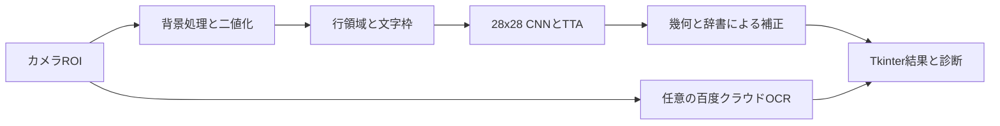

# Handwritten Character Recognition and Correction

数字・大小英字を対象とする、カメラOCR、文字分割、幾何・辞書補正の実験システムです。

[简体中文](README.md) · [English](README_EN.md) · **日本語**

**詳細：** [技術ノート](docs/technical-notes.ja.md) · [導入と操作](docs/setup.ja.md)

PyTorchの62クラスCNNにOpenCVの前処理、行領域分割、文字正規化、テスト時拡張を組み合わせ、Tkinterで観察・操作できる処理系を構築しています。単一文字分類を文字列処理へ接続する際の課題を扱います。百度の手書きOCRは任意のクラウド参照で、ローカルCNNの学習には使いません。

## 処理の流れ



主な入口は`desktop_app.py`です。GUIでプレビューを更新し、SpaceでROIを固定して1本のワーカーへ渡します。ローカル処理後にクラウド要求を行うため、両結果を並列に独立表示する構造ではありません。

## 機能と設計

| モジュール | 実装 |
| :--- | :--- |
| 画像適応 | 境界輝度で背景を判定。明背景は背景除算・CLAHE・適応的二値化、暗背景はフィルタ・Otsu。 |
| 文字分割 | 行投影、行内輪郭、反復的な枠結合、幅広領域の投影分割、横書き／縦書き順序のヒューリスティック。 |
| 分類 | 3畳み込みブロック、SiLU、BatchNorm、Dropout、28×28入力・62クラス。9平行移動と2回転の確率平均。 |
| 補正 | 縦横比、ROI全体の相対高さ、数字と英字の混同、同じ長さの辞書尤度、書式マスク。 |
| GUI | 生出力・補正・クラウド結果、低確信度Top-3、二値画像、番号付き枠、固定／再開、カメラ切替。 |

[ソース・構造・数式](docs/technical-notes.ja.md)。辞書照合は生成言語モデルではなく、書式マスクも完全な身分証検証や漢字ナンバープレート認識ではありません。

## 表示例と検証範囲


数字、複数行、電話番号風文字列、英数字混在のスクリーンショット、学習曲線・混同行列を保存しています。過去の画面・結果の例であり、現行の精度や速度を単独では証明しません。

今回、分割アサーション3件と補正ケース7件が通過しました。再学習、カメラ試験、クラウド要求は行っていません。過去のアブレーションJSONは[評価条件](docs/technical-notes.ja.md#evaluation)とともに残します。合成文字列と正解由来の幾何特徴による結果を、実画像の端から端までの精度とは扱いません。

## クイックスタート

1. Tkinter対応Python3.10+で`requirements.txt`を導入し、実機に合うTorch／torchvisionを選びます。
2. 対応する `checkpoints/emnist_model.pth` を用意し、[重みの再現手順](docs/checkpoint.ja.md)を確認します。現在公開ダウンロードはなく、既存のローカル重みは保持します。
3. リポジトリのルートで実行します。

```powershell
python desktop_app.py
```

Spaceで認識／再開、Enter/Escで再開、Cでカメラ、Bでクラウド、Qで終了。[導入・認証情報・学習](docs/setup.ja.md)を参照してください。

## 実装範囲と今後

対象は`0–9/A–Z/a–z`です。漢字・句読点・連続筆記のエンドツーエンド系列モデルはありません。分割、配置、補正の規則により、誤分割・誤結合・固有名詞の誤修正が起こり得ます。

学習/検証はシード42で不重複90/10索引を分け、別データセットを使用します。検証に確率的拡張はなく、学習とDataLoaderワーカーにもシードを設定します。旧曲線は再生成せず、精度向上を測定した意味ではありません。 2026-10-23修正：重み欠落・非互換は初期化エラーとして終了し、デスクトップに通知します。無作為モデルでの推論はしません。新規信頼性7件、既存分割3件・補正7件が通過しました。再学習、実撮影評価、クラウド呼出しは行っていません。実画像評価とデータ・重み版の記録は今後必要です。

## 帰属とライセンス

**刘超然 / Chaoran Liu**が管理しています。CNN、画像処理、復号、GUIの統合を示すソースですが、個人・チームの詳細分担を裏付ける独立記録はなく、既存手法を全面的な独創研究とは主張しません。

アプリコードは[MIT](LICENSE)、PyTorch、torchvision、OpenCV、EMNIST、百度サービスは各条件に従います。[技術ノート](docs/technical-notes.ja.md) · [導入](docs/setup.ja.md)
