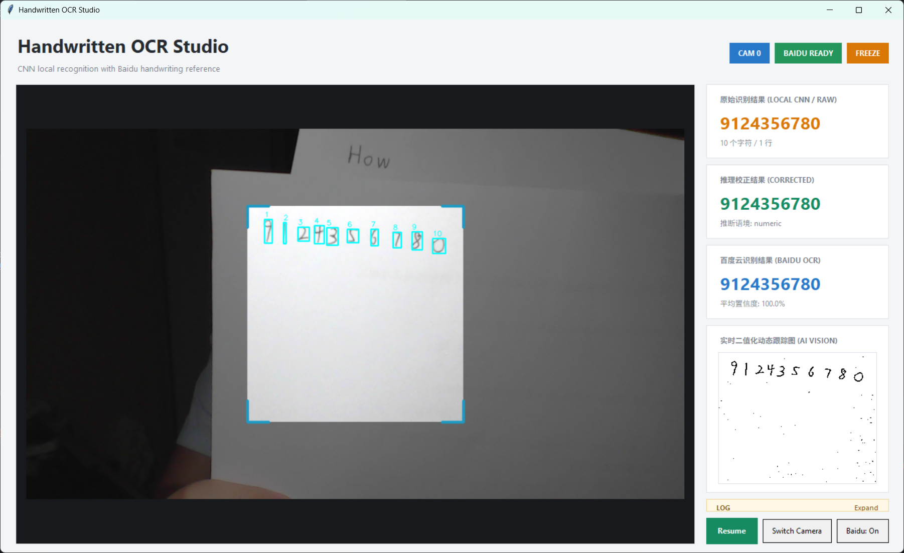
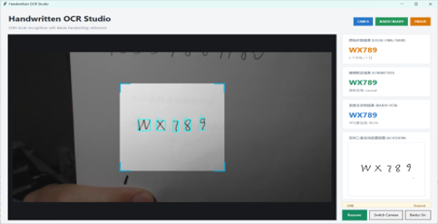
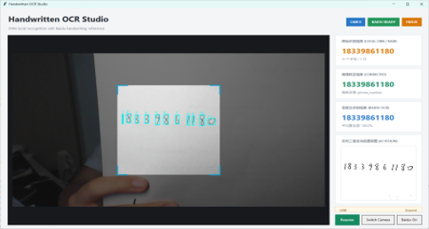

# Handwritten Character Recognition and Correction — 技術ノート

[简体中文](technical-notes.zh-CN.md) · [English](technical-notes.en.md) · **日本語** · [概要](../README_JA.md)

<a id="source-map"></a>

## ソースと入口

| パス | 役割 |
| :--- | :--- |
| [desktop_app.py](../desktop_app.py) | 主GUI、カメラ、1ワーカー、80 ms結果ポーリング、固定画面への枠描画。 |
| [src/local_ocr.py](../src/local_ocr.py) | 前処理、分割、順序、11変体推論、単語単位の補正。 |
| [src/model.py](../src/model.py)／[src/utils.py](../src/utils.py) | CNN、ラベル、EMNIST方向修正、拡張と分割。 |
| [src/corrector.py](../src/corrector.py)／[辞書](../src/words.txt) | 重複除外した5459語、確率調整、文字数候補と書式マスク。 |
| [train.py](../train.py)／[predict.py](../predict.py) | 学習と別系統の評価表示。predictは9平行移動で、主入口の11変体とは異なります。 |
| [ablation_benchmark.py](../ablation_benchmark.py) | 単一文字・合成文字列の評価。下記の制約あり。 |
| [src/baidu_ocr.py](../src/baidu_ocr.py) | 認証情報、HTTPトークン、JPEG/Base64要求、応答解析。 |

`camera_detect.py`は別のOpenCV画面です。新版分割を共用しますが前後処理は独立しており、Tkinterと同一とは扱いません。`baiduocr/`は過去の独立例で、主クライアントは`src/baidu_ocr.py`です。

<a id="preprocessing"></a>

## 画像・文字・配置

`recognize`は境界平均輝度127で背景を分けます。明背景のGaussianカーネルは最大辺の約8%を奇数化し、CLAHE2.0／8×8、局所窓約1.5%かつ最小3、定数4です。暗背景は除算せず中値・Gaussian・Otsuです。プレビューは固定51カーネルと別閾値であり、推論入力と同一ではありません。

水平行領域を推定し、行内で2×2のクロージング／オープニング、輪郭選別、反復結合を行います。幅広領域は投影の谷から複数に切り、単なる二等分ではありません。連続筆記・縦書きへの普遍的な保証はなく、画素閾値と正方形ROIの仮定が残ります。

密度で膨張／収縮し、長辺20へ縮小して28×28に配置、画像モーメントで重心を平行移動します。

```math
\Delta x=14-\frac{M_{10}}{M_{00}},\qquad \Delta y=14-\frac{M_{01}}{M_{00}}
```

最近傍方向の投票で行・列を選び、間隔が`max(10,0.55×平均文字寸法)`を超えると単語を分けます。相対高さは行ごとではなくROI全体の基準です。横書きの行結果は最終的に空白で連結されます。

<a id="network"></a>

## CNNと学習設定

3×3畳み込み3段は`1→32→64→128`、BatchNorm／SiLUです。前2段に2×2プーリングとDropout2d0.15、全結合は6272→512→62でDropout0.5。初期化は`kaiming_normal_(mode='fan_out', nonlinearity='relu')`で、実際の活性化はSiLUです。旧版の入力チャネル数だけの初期化式は正確ではありません。

主推論は1画素平行移動9種と±5°回転のSoftmaxを平均します。

```math
\bar p(c\mid x)=\frac1{11}\sum_{k=1}^{11}\mathrm{softmax}(f(T_kx))_c
```

学習/検証はシード42で不重複90/10索引を分け、別データセットを使用します。検証に確率的拡張はなく、学習とDataLoaderワーカーにもシードを設定します。旧曲線は再生成せず、精度向上を測定した意味ではありません。

設定はbatch128、Adam lr0.001／weight_decay1e-4、ラベル平滑化0.1、損失調整patience3／factor0.5、最大25エポック、7回精度不向上で早期終了、CUDA AMPです。設定やGPU表示文字列だけで実行機器・完了回数・成績は確定しません。

<a id="decoding"></a>

## 確率補正と対話上の制約

縦横比0.52、相対高さ0.78、文脈の重みで再正規化します。Top-1が0.80未満、または上位2候補差0.20未満でTop-3を提示しますが、校正済み精度ではありません。

辞書は**同じ文字数**のみで、大小文字確率を合計した対数尤度です。明示的な単語頻度事前分布や神経言語モデルはありません。

```math
W^*=\arg\max_{W\in D_N}\sum_{i=1}^{N}\ln\left(p_i(w_i^{lower})+p_i(w_i^{upper})+10^{-12}\right)
```

採点は現在`pruned_candidates`を走査します。O(1)復号、固定遅延、精度を損なわない高速化は主張しません。

長さ・文字数規則から18桁身分証風、11桁電話風、車番風、英字、数字のマスクを選びます。チェックサム、番号の実在性、漢字の地域名は認識・検証しません。誤った形式判定は過度な制約になります。

GUIの30 msは追加のコールバック間隔、結果確認は80 msであり、30 FPSや22.6 msの保証ではありません。ワーカーはローカル後にクラウドを実行し、両結果の表示が遅れる場合があります。重みが欠落・非互換の場合は初期化を中止し、デスクトップ入口でエラーダイアログを表示します。ランダム初期値で推論を継続しません。

<a id="evaluation"></a>

## 過去の結果と評価条件

[保存JSON](../checkpoints/ablation_benchmark_results.json)は2026-09-14、CUDA、5000単一文字、50合成文字列です。

| 段階 | 記録の単一文字% | 記録の文字列% |
| :--- | ---: | ---: |
| M1 | 84.24 | 16 |
| M2 | 84.98 | 12 |
| M3 | 84.90 | 14 |
| M4 | 86.51 | 46 |
| M5 | 87.17 | 90 |

現行カメラの指標ではありません。M1は追加平行移動、M2は元データを直接使い重心処理を呼びません。文字列は正解ラベル別に字画像を抽出し、比率・高さを正解文字から与え、M4には数字／英字の正解文脈も渡します。M1–M3とM4–M5の単一文字は異なる集合、M5の文字列比較は大小を無視します。行間の差分を独立の性能寄与とは扱えず、撮影・分割誤差も含みません。

[曲線](images/training_curves.png)、[混同行列](images/confusion_matrix.png)、[拡張例](images/data_augmentation_samples.png)は過去の可視化として保持します。生のエポック記録、重みとの紐付け、全体再現が不足し、83%を現行の独立検証済みテスト精度とはしません。

| 過去の画面 | 過去の画面 |
| :---: | :---: |
|  |  |
|  |  |

<a id="implementation-status"></a>

## 検証状態と今後

分割アサーション3件と補正ケース7件が通過しました。カメラ、クラウド、実モデル評価は使いません。ソースからアルゴリズム・設定・GUI経路を確認しましたが、Git対象外の本機重みはクローンへの同梱を意味しません。

旧`demo2.py`は多言語API資料で、内容を保持して`baiduocr/baidu_api_examples.md`へ改名しました。現在のPythonソースは静的解析を通過します。

2026-10-23修正：重み欠落・非互換は初期化エラーとして終了し、デスクトップに通知します。無作為モデルでの推論はしません。新規信頼性7件、既存分割3件・補正7件が通過しました。再学習、実撮影評価、クラウド呼出しは行っていません。過去チェックポイントはバージョン付きで公開し、サイズとSHA-256を記録しています。[重みの説明](checkpoint.ja.md)を参照してください。独立した実画像評価とデータ版管理は今後の課題です。
